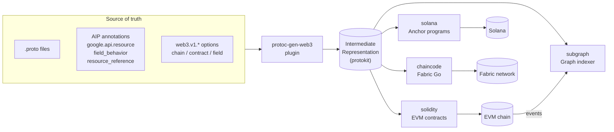
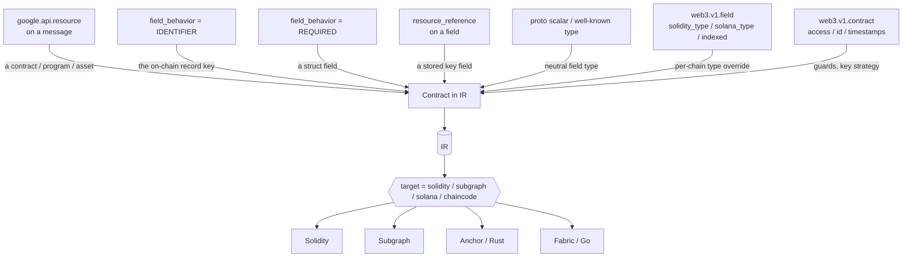

# web3

> **Protobuf → multi-chain** — compile one annotated schema to **EVM** (Solidity
> storage contracts + a [The Graph](https://thegraph.com/) subgraph), **Solana**
> (Anchor/Rust programs), and **Hyperledger Fabric** (Go chaincode). One source of
> truth: the same protos that describe your API describe your on-chain state, on
> every chain.

[](https://pkg.go.dev/github.com/the-protobuf-project/web3)
[](LICENSE)

## Contents

- [Overview](#overview)
- [Features](#features)
- [Architecture](#architecture)
- [How it works](#how-it-works)
- [Install](#install)
- [Quick start](#quick-start)
- [Output layout](#output-layout)
- [Annotations reference](#annotations-reference)
- [Type mapping](#type-mapping)
- [Examples](#examples)
- [Defaults & on-chain notes](#defaults--on-chain-notes)
- [Project layout](#project-layout)
- [License](#license)

## Overview

**web3** is a [protoc](https://protobuf.dev/) plugin (`protoc-gen-web3`) that turns
Protobuf resource definitions into on-chain artifacts for **three chains**.
Annotate your messages with the [Google AIP](https://google.aip.dev/) standards
(`google.api.resource`, `field_behavior`, `resource_reference`) plus a thin layer
of chain-native `web3.v1` options, and web3 emits a contract/program per resource —
from the same protos an API (or a database, via
[orm](https://github.com/the-protobuf-project/orm)) is built from.

| Chain | Target | Output |
| --- | --- | --- |
| **EVM** | `solidity` | A self-contained CRUD storage contract per resource + a Foundry project: struct, `key → record` mapping, `create`/`get`/`update`/`remove`/`list`/`count`/`exists`, lifecycle events, `SCHEMA_VERSION`, access control |
| **EVM** | `subgraph` | A buildable [Graph](https://thegraph.com/) subgraph: `schema.graphql` (`@entity` per resource), `subgraph.yaml` manifest, ABIs, AssemblyScript event handlers |
| **Solana** | `solana` | An [Anchor](https://www.anchor-lang.com/) (Rust) program per schema: a PDA-backed `#[account]` and `create`/`update`/`close` instructions per resource, `#[derive(InitSpace)]`, Cargo/Anchor workspace |
| **Fabric** | `chaincode` | A [Hyperledger Fabric](https://www.hyperledger.org/projects/fabric) Go chaincode: a `contractapi.Contract` per resource with world-state `Create`/`Read`/`Update`/`Delete`/`List`/`Exists`, module scaffold |

One schema, one field annotation, four native outputs — each field's storage type
is chosen per chain (`address` on EVM, `Pubkey` on Solana, a Go type on Fabric).
Every target also emits a `README.md` with a Mermaid ER diagram, so the generated
tree is self-documenting.

## Features

- **AIP-native + chain-native.** Resources, keys, and references come straight from
  the standard Google annotations; only the on-chain specifics need `web3.v1.*`.
- **Per-chain type overrides.** One `web3.v1.field` carries `solidity_type` /
  `solana_type` subfields, so a `string` wallet becomes an `address` on EVM and a
  `Pubkey` on Solana, and `bytes` becomes `bytes32` / `[u8; 32]` — from the same
  field. Unset fields fall back to a sensible neutral projection.
- **One IR, shared with the database plugin.** web3 renders from the exact same
  intermediate representation that [orm](https://github.com/the-protobuf-project/orm)
  does — the generic engine is [protokit](https://github.com/the-protobuf-project/protokit) —
  so your database schema and your on-chain state can never drift apart.
- **Natural on-chain keys.** On EVM the AIP `IDENTIFIER` field *is* the record key —
  no surrogate id to reconcile, so a contract addresses a record by its resource
  name. (Synthesize a ULID/UUID key explicitly with `contract.id` when you want one.)
- **Access control, built in.** `web3.v1.contract.access` wires an open, `Ownable`,
  or per-record-owner guard into each contract's write methods, on every chain.
- **Indexed events.** `web3.v1.field.indexed` promotes a field to an indexed EVM
  event topic (within the 3-topic limit), so a subgraph or log filter can query
  records by it.
- **Storage-layout fingerprint.** Each EVM contract exposes a `bytes32
  SCHEMA_VERSION` hash of its layout; a client refuses a deployed contract whose
  fingerprint drifted from the one it was generated against.
- **Deterministic.** Re-running on unchanged protos produces byte-identical output
  (enforced by golden tests across all four targets).

## Architecture



web3 builds everything into one IR, then each target renders it independently.
Files that declare the **same namespace merge into one output tree**, so a
multi-file proto package becomes a single project. The IR is built by
[protokit](https://github.com/the-protobuf-project/protokit), a generic engine, so
the database plugin ([orm](https://github.com/the-protobuf-project/orm)) renders
from the exact same model — protokit imports no chain concept; web3 supplies a
`schema.Backend` that reads `web3.v1` and folds in the on-chain rendering.

## How it works

Every annotation maps to a concrete piece of the contract. web3 collects them into
the IR, applies its defaults, then hands the IR to the selected renderer, which
projects each field to its chain-native type.



## Install

```bash
go install github.com/the-protobuf-project/web3/plugin/cmd/protoc-gen-web3@latest
```

The plugin must be on your `PATH` so `protoc`/`buf` can find it. You'll also need
the option definitions on your import path; with [buf](https://buf.build) add the
module to your `buf.yaml` `deps`, then `import "web3/v1/annotations.proto";`.

## Quick start

**1. Annotate a proto** — one schema, chain-native field types.

```proto
syntax = "proto3";
package leasing.v1;

import "google/api/field_behavior.proto";
import "google/api/resource.proto";
import "web3/v1/annotations.proto";

option (web3.v1.chain) = {
  namespace: "leasing"
  chain: CHAIN_EVM        // CHAIN_EVM | CHAIN_SOLANA | CHAIN_FABRIC
};

message Agreement {
  option (google.api.resource) = {
    type: "leasing.v1/Agreement"
    pattern: "agreements/{agreement}"
    singular: "agreement"
    plural: "agreements"
  };
  // The creator of an agreement is the only account that may change it.
  option (web3.v1.contract) = { access: ACCESS_CONTROL_PER_RECORD_OWNER };

  string id = 1 [(google.api.field_behavior) = IDENTIFIER];

  string landlord = 2 [(web3.v1.field) = {
    solidity_type: "address"
    solana_type: "Pubkey"
    indexed: true
  }];
  string tenant = 3 [(web3.v1.field) = {
    solidity_type: "address"
    solana_type: "Pubkey"
    indexed: true
  }];

  bytes  property_hash = 4 [(web3.v1.field) = {solidity_type: "bytes32", solana_type: "[u8; 32]"}];
  uint64 rent_wei      = 5 [(web3.v1.field) = {solidity_type: "uint256"}];
}
```

**2. Add the target(s) to `buf.gen.yaml`.**

```yaml
version: v2
plugins:
  - local: protoc-gen-web3
    out: generated/solidity
    opt: [target=solidity]    # solidity | subgraph | solana | chaincode
```

**3. Generate** — `buf generate`.

### What comes out

The `Agreement` message becomes native storage on each chain — note how `landlord`
is an `address` / `Pubkey` / `string` and `indexed` fields become event topics:

```solidity
// EVM (target=solidity), trimmed
contract AgreementStore {
    bytes32 public constant SCHEMA_VERSION = 0x…;
    struct Agreement {
        string  id;             // the AIP identifier is the record key
        address landlord;
        address tenant;
        bytes32 propertyHash;
        uint256 rentWei;        // uint64 → the idiomatic on-chain word
    }
    event AgreementCreated(string key, address indexed landlord, address indexed tenant);
    function create(Agreement calldata record) external { … }   // per-record-owner guarded
    // get / update / remove / list / count / exists …
}
```

```rust
// Solana (target=solana), trimmed
#[account]
#[derive(InitSpace)]
pub struct Agreement {
    #[max_len(64)] pub id: String,
    pub landlord: Pubkey,
    pub tenant: Pubkey,
    pub property_hash: [u8; 32],
    pub rent_wei: u64,
    pub owner: Pubkey,          // per-record access
}
// create_agreement / update_agreement / close_agreement instructions, PDA-keyed
```

```go
// Fabric (target=chaincode), trimmed
type Agreement struct {
    ID           string `json:"id"`
    Landlord     string `json:"landlord"`
    Tenant       string `json:"tenant"`
    PropertyHash []byte `json:"property_hash"`
    RentWei      uint64 `json:"rent_wei"`
    Owner        string `json:"owner"`
}
// AgreementContract: Create / Read / Update / Delete / List / Exists over the world state
```

## Output layout

Files sharing a namespace merge into one tree per target:

```text
generated/solidity/leasing/            # EVM contracts + Foundry project
├── foundry.toml, .gitignore, README.md
└── leasingv1/Agreement.sol, types.sol

generated/subgraph/leasing/            # The Graph subgraph
├── subgraph.yaml, schema.graphql, package.json, README.md
├── abis/AgreementStore.json
└── src/leasingv1.ts

generated/solana/leasing/              # Anchor workspace
├── Anchor.toml, Cargo.toml, README.md
└── programs/leasing_v1/{Cargo.toml, src/lib.rs}

generated/chaincode/leasing/           # Fabric Go chaincode
├── go.mod, main.go, README.md         # go.mod omitted when the go_module opt is set
└── leasingv1/contract.go
```

Build them with the usual toolchains:

```bash
cd generated/solidity/leasing  && forge build
cd generated/subgraph/leasing  && npm install && graph codegen && graph build
cd generated/solana/leasing    && anchor keys sync && anchor build
cd generated/chaincode/leasing && go build ./...
```

## Annotations reference

All options live in `web3/v1/annotations.proto` and are chain-native — there are no
database nouns.

### `(web3.v1.chain)` — file level

| Field | Description |
| --- | --- |
| `namespace` | Output tree name. Files sharing it merge into one tree. Defaults to the last package segment. |
| `group` | Override the sub-namespace (module/package) for the file's contracts. Inferred from the resource type otherwise. |
| `chain` | Target chain: `CHAIN_EVM` (default), `CHAIN_SOLANA`, `CHAIN_FABRIC`. Selects the key strategy and the type-override subfield read. |

### `(web3.v1.contract)` — message level

| Field | Description |
| --- | --- |
| `name` | Explicit contract/program/asset name. Defaults to the resource type suffix. |
| `skip` | Exclude the message from all output. |
| `id` | `ID_STRATEGY_ULID` / `ID_STRATEGY_UUID` — synthesize a generated record key (the AIP identifier becomes a unique field). Unset keeps the natural identifier as the key. |
| `timestamps` | Add `created_at` / `updated_at` fields (block time). |
| `access` | Write guard: `ACCESS_CONTROL_UNSPECIFIED` (open), `ACCESS_CONTROL_OWNABLE`, or `ACCESS_CONTROL_PER_RECORD_OWNER`. |

### `(web3.v1.field)` — field level

| Field | Description |
| --- | --- |
| `name` | Explicit field name (defaults to the proto field name). |
| `skip` | Field exists in the proto but not on-chain. |
| `solidity_type` | EVM type override: `address`, `uint256`, `uint128`, `bytes32`, `int128`, … Empty keeps the neutral projection. |
| `solana_type` | Solana/Anchor Rust type override: `Pubkey`, `[u8; 32]`, `u64`, … Empty keeps the neutral projection. |
| `indexed` | Promote to an indexed EVM event topic (capped at the 3-topic limit); ignored by non-EVM targets. |

## Type mapping

The IR stores a **neutral, target-agnostic** type per field; each target projects it
onto its chain's native type (or uses your `solidity_type` / `solana_type`
override). Fabric derives Go types directly.

| Proto | Solidity (EVM) | Rust (Solana) | Go (Fabric) |
| --- | --- | --- | --- |
| `string`, ULID/UUID key | `string` | `String` | `string` |
| `bool` | `bool` | `bool` | `bool` |
| `int32` / `uint32` | `int32` / `int64` | `i32` / `u32` | `int32` / `uint32` |
| `int64` | `int64` | `i64` | `int64` |
| `uint64`, `Timestamp`, `Decimal` | `uint256` | `u64` / `u128` | `uint64` |
| `bytes` | `bytes` | `Vec<u8>` | `[]byte` |
| `double` / `float` | `string` | `f64` / `f32` | `float64` / `float32` |
| `enum` | file-level Solidity `enum` | Rust `enum` | Go string-typed enum |
| `repeated` scalar | `T[]` | `Vec<T>` | `[]T` |
| *(override)* wallet `string` | **`address`** | **`Pubkey`** | `string` |
| *(override)* hash `bytes` | **`bytes32`** | **`[u8; 32]`** | `[]byte` |

## Examples

`examples/proto` holds two ready-to-generate schemas exercising the annotations:

- **`leasing.v1/Agreement`** — a lease between wallets (`address` / `Pubkey`),
  per-record ownership, a `bytes32` document hash, `uint256` rent/deposit.
- **`payroll.v1/Payslip`** — an `Ownable` salary record (employer/employee wallets,
  gross/tax/net amounts).

Generate all four targets for both:

```bash
go build -o /tmp/protoc-gen-web3 ./plugin/cmd/protoc-gen-web3
PATH=/tmp:$PATH buf generate --template buf.gen.example.yaml
```

Output lands under `examples/generated/{solidity,subgraph,solana,chaincode}`. The
examples are a **separate Go module** (`examples/go.mod`) so the generated Fabric
chaincode's dependencies don't pollute the plugin; a top-level `go.work` wires the
plugin module and the examples module together for local development.

## Defaults & on-chain notes

- **Record key.** On EVM (and Fabric), the AIP `IDENTIFIER` field is the record key
  by default — no surrogate. Set `contract.id` to synthesize a ULID/UUID key
  instead. A dynamic (`string`/`bytes`) EVM key is emitted non-`indexed` in events
  so off-chain indexers can recover its value, not just its topic hash.
- **Immutable EVM storage.** Contracts have no migrations — a `.proto` change means a
  new `SCHEMA_VERSION` and a new deployment. Replay the old contract's events into
  the new one, or keep the address stable behind a UUPS proxy and only ever *append*
  struct fields (never reorder or retype), preserving the storage layout.
- **Solana PDAs.** Each record lives at a PDA seeded on its key; dynamic fields carry
  `#[max_len(..)]` so `InitSpace` can size the rent-exempt account (tune the caps to
  your data). Run `anchor keys sync` before deploying.
- **Fabric world state.** Assets are JSON-serialized under a `<Asset>:<key>` key.
- **Foreign keys** are stored as plain key fields; no cross-contract constraint is
  enforced on-chain. The subgraph turns them into GraphQL relations for querying.
- **Deterministic** output, verified by golden tests.

## Project layout

```text
plugin/
  cmd/protoc-gen-web3/     the plugin binary
  generator/
    registry.go           the target registry (solidity, subgraph, solana, chaincode)
    backend/              web3's schema.Backend (reads web3.v1, folds in rendering) + web3.yaml config
    types/                per-chain type projections (EVM / Solana / Fabric)
    solidity/ subgraph/ solana/ chaincode/   the four targets + their templates
  pb/web3v1/              generated Go stubs for the web3.v1 options
protobuf/web3/v1/         the web3.v1 option protos (chain / contract / field)
examples/                 separate module: leasing + payslip protos and generated output
```

The generic IR engine lives in the separate
[protokit](https://github.com/the-protobuf-project/protokit) module; the database
(gorm/sql/prisma) targets ship as [orm](https://github.com/the-protobuf-project/orm).

## License

Licensed under the [Apache License, Version 2.0](LICENSE).
