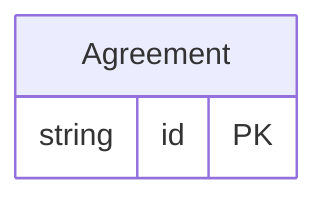

<!-- Code generated by protoc-gen-web3. DO NOT EDIT. -->

# `leasing` — Fabric chaincode

A contractapi.Contract per resource with world-state CRUD — one Go chaincode module per database.

Generated from Protobuf by protoc-gen-web3. Source of truth is the `.proto` files — regenerate rather than editing.

| Models | Enums |
| ---: | ---: |
| 1 | 1 |

## Entity relationships

## Output

- `<schema>/contract.go` — an asset struct per resource plus a `contractapi.Contract` with `Create`/`Read`/`Update`/`Delete`/`List`/`Exists` transactions keyed by the record key. Writes are gated by the `access` model (open, an owner client identity, or per-record owner).
- `main.go` — the chaincode entrypoint that registers every generated contract; `go.mod` pins the fabric-contract-api-go dependency. Run `go build` from the database directory.
- Assets are JSON-serialized into the Fabric world state under a `<Asset>:<key>` composite key. Foreign keys are stored as plain key fields (no cross-asset constraint is enforced on-chain).

## Schema `leasing_v1`

### `Agreement` → `agreements`

Agreement is an on-chain lease between a landlord and a tenant. Per-record ownership: the account that creates an agreement is the only one that may update or terminate it.

| Column | Type | Null |
| --- | --- | --- |
| `id` | `string` | not null |
| `landlord` | `string` | not null |
| `tenant` | `string` | not null |
| `property_hash` | `[]byte` | nullable |
| `rent_wei` | `uint64` | nullable |
| `deposit_wei` | `uint64` | nullable |
| `start_date` | `int64` | nullable |
| `end_date` | `int64` | nullable |
| `status` | `LeaseStatus` | nullable |

### Enums

- `LeaseStatus`: ACTIVE, TERMINATED, COMPLETED
