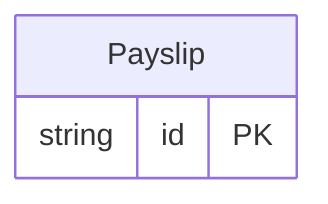

<!-- Code generated by protoc-gen-web3. DO NOT EDIT. -->

# `payroll` — Fabric chaincode

A contractapi.Contract per resource with world-state CRUD — one Go chaincode module per database.

Generated from Protobuf by protoc-gen-web3. Source of truth is the `.proto` files — regenerate rather than editing.

| Models | Enums |
| ---: | ---: |
| 1 | 0 |

## Entity relationships

## Output

- `<schema>/contract.go` — an asset struct per resource plus a `contractapi.Contract` with `Create`/`Read`/`Update`/`Delete`/`List`/`Exists` transactions keyed by the record key. Writes are gated by the `access` model (open, an owner client identity, or per-record owner).
- `main.go` — the chaincode entrypoint that registers every generated contract; `go.mod` pins the fabric-contract-api-go dependency. Run `go build` from the database directory.
- Assets are JSON-serialized into the Fabric world state under a `<Asset>:<key>` composite key. Foreign keys are stored as plain key fields (no cross-asset constraint is enforced on-chain).

## Schema `payroll_v1`

### `Payslip` → `payslips`

Payslip is an on-chain salary payment record. Ownable: only the deploying employer authority may write payslips; reads stay open so an employee can verify their own record.

| Column | Type | Null |
| --- | --- | --- |
| `id` | `string` | not null |
| `employer` | `string` | not null |
| `employee` | `string` | not null |
| `gross_wei` | `uint64` | nullable |
| `tax_wei` | `uint64` | nullable |
| `net_wei` | `uint64` | nullable |
| `period` | `string` | not null |
| `paid_at` | `int64` | nullable |
