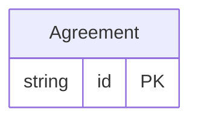

<!-- Code generated by protoc-gen-web3. DO NOT EDIT. -->

# `leasing` — Solana programs

An Anchor program per schema — a PDA-backed account and create/update/close instructions per resource.

Generated from Protobuf by protoc-gen-web3. Source of truth is the `.proto` files — regenerate rather than editing.

| Models | Enums |
| ---: | ---: |
| 1 | 1 |

## Entity relationships

## Output

- `programs/<schema>/src/lib.rs` — the `#[program]` module: an `#[account]` struct per resource plus `create`/`update`/`close` instructions keyed by a PDA seeded on the record key. Writes are gated by the `access` model (open, program authority, or per-record owner).
- `programs/<schema>/Cargo.toml` — the program crate; `Anchor.toml` + `Cargo.toml` at the root form the workspace. Run `anchor build` from the database directory.
- Dynamic fields (String, Vec) carry `#[max_len(..)]` so `#[derive(InitSpace)]` can size the rent-exempt account; adjust the caps to your data.
- `declare_id!` carries an all-ones placeholder — run `anchor keys sync` to bind real program ids before deploying.

## Schema `leasing_v1`

### `Agreement` → `agreements`

Agreement is an on-chain lease between a landlord and a tenant. Per-record ownership: the account that creates an agreement is the only one that may update or terminate it.

| Column | Type | Null |
| --- | --- | --- |
| `id` | `String` | not null |
| `landlord` | `Pubkey` | not null |
| `tenant` | `Pubkey` | not null |
| `property_hash` | `[u8; 32]` | nullable |
| `rent_wei` | `u64` | nullable |
| `deposit_wei` | `u64` | nullable |
| `start_date` | `i64` | nullable |
| `end_date` | `i64` | nullable |
| `status` | `LeaseStatus` | nullable |

### Enums

- `LeaseStatus`: ACTIVE, TERMINATED, COMPLETED
