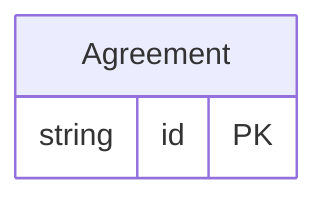

<!-- Code generated by protoc-gen-web3. DO NOT EDIT. -->

# `leasing` — The Graph subgraph

An off-chain index of the on-chain storage contracts — one @entity per resource.

Generated from Protobuf by protoc-gen-web3. Source of truth is the `.proto` files — regenerate rather than editing.

| Models | Enums |
| ---: | ---: |
| 1 | 1 |

## Entity relationships

## Output

- `schema.graphql` — one `@entity` per resource; foreign keys become references and the reverse side is a `@derivedFrom` list.
- `subgraph.yaml` — the manifest: one dataSource per resource contract, handling its `Created`/`Updated`/`Deleted` events. Fill in each contract `address` and `startBlock` after deployment.
- `abis/<Contract>.json` — the events and `get()` view each mapping binds to.
- `src/<schema>.ts` — AssemblyScript handlers that read a record via `get(key)` and upsert the entity; a Deleted event removes it.
- Build with the Graph CLI: `npm install` then `graph codegen && graph build` from this directory.

## Schema `leasing_v1`

### `Agreement` → `agreements`

Agreement is an on-chain lease between a landlord and a tenant. Per-record ownership: the account that creates an agreement is the only one that may update or terminate it.

| Column | Type | Null |
| --- | --- | --- |
| `id` | `string` | not null |
| `landlord` | `address` | not null |
| `tenant` | `address` | not null |
| `property_hash` | `bytes32` | nullable |
| `rent_wei` | `uint256` | nullable |
| `deposit_wei` | `uint256` | nullable |
| `start_date` | `int64` | nullable |
| `end_date` | `int64` | nullable |
| `status` | `LeaseStatus` | nullable |

### Enums

- `LeaseStatus`: ACTIVE, TERMINATED, COMPLETED
