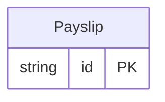

<!-- Code generated by protoc-gen-web3. DO NOT EDIT. -->

# `payroll` — The Graph subgraph

An off-chain index of the on-chain storage contracts — one @entity per resource.

Generated from Protobuf by protoc-gen-web3. Source of truth is the `.proto` files — regenerate rather than editing.

| Models | Enums |
| ---: | ---: |
| 1 | 0 |

## Entity relationships

## Output

- `schema.graphql` — one `@entity` per resource; foreign keys become references and the reverse side is a `@derivedFrom` list.
- `subgraph.yaml` — the manifest: one dataSource per resource contract, handling its `Created`/`Updated`/`Deleted` events. Fill in each contract `address` and `startBlock` after deployment.
- `abis/<Contract>.json` — the events and `get()` view each mapping binds to.
- `src/<schema>.ts` — AssemblyScript handlers that read a record via `get(key)` and upsert the entity; a Deleted event removes it.
- Build with the Graph CLI: `npm install` then `graph codegen && graph build` from this directory.

## Schema `payroll_v1`

### `Payslip` → `payslips`

Payslip is an on-chain salary payment record. Ownable: only the deploying employer authority may write payslips; reads stay open so an employee can verify their own record.

| Column | Type | Null |
| --- | --- | --- |
| `id` | `string` | not null |
| `employer` | `address` | not null |
| `employee` | `address` | not null |
| `gross_wei` | `uint256` | nullable |
| `tax_wei` | `uint256` | nullable |
| `net_wei` | `uint256` | nullable |
| `period` | `string` | not null |
| `paid_at` | `int64` | nullable |
