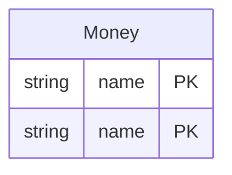

<!-- Code generated by protoc-gen-web3. DO NOT EDIT. -->

# `commerce` — Fabric chaincode

A contractapi.Contract per resource with world-state CRUD — one Go chaincode module per database.

Generated from Protobuf by protoc-gen-web3. Source of truth is the `.proto` files — regenerate rather than editing.

| Models | Enums |
| ---: | ---: |
| 2 | 2 |

## Entity relationships

## Output

- `<schema>/contract.go` — an asset struct per resource plus a `contractapi.Contract` with `Create`/`Read`/`Update`/`Delete`/`List`/`Exists` transactions keyed by the record key. Writes are gated by the `access` model (open, an owner client identity, or per-record owner).
- `main.go` — the chaincode entrypoint that registers every generated contract; `go.mod` pins the fabric-contract-api-go dependency. Run `go build` from the database directory.
- Assets are JSON-serialized into the Fabric world state under a `<Asset>:<key>` composite key. Foreign keys are stored as plain key fields (no cross-asset constraint is enforced on-chain).

## Schema `shop_cart_v1`

### `Money` → `moneys`

Money is a cart-side resource. Its simple name "Money" collides with the order-side Money once both packages merge into the "commerce" database (see protorm.yaml). Prisma qualifies the colliding model names (its models share one global namespace), while the schema-namespaced targets — GORM (one package per schema), SQL, and CSV — keep the bare "Money", since the schema already disambiguates them.

| Column | Type | Null |
| --- | --- | --- |
| `name` | `string` | not null |
| `amount` | `int64` | not null |
| `status` | `Status` | not null |

### Enums

- `Status`: PENDING, PAID

## Schema `shop_order_v1`

### `Money` → `moneys`

Money is the order-side resource sharing the simple name "Money" with the cart-side one. See cart.proto for how each target renders the collision.

| Column | Type | Null |
| --- | --- | --- |
| `name` | `string` | not null |
| `amount` | `int64` | not null |
| `status` | `Status` | not null |

### Enums

- `Status`: SHIPPED, DELIVERED
