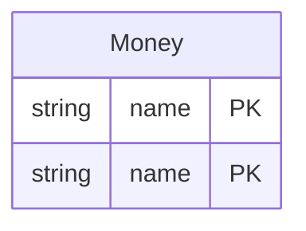

<!-- Code generated by protoc-gen-web3. DO NOT EDIT. -->

# `commerce` — Solidity contracts

A self-contained CRUD storage contract per resource — one Solidity file per model.

Generated from Protobuf by protoc-gen-web3. Source of truth is the `.proto` files — regenerate rather than editing.

| Models | Enums |
| ---: | ---: |
| 2 | 2 |

## Entity relationships

## Output

- `<schema>/<Model>.sol` — one storage contract per resource: a struct mirroring the columns, a key→record mapping, and `create`/`get`/`update`/`remove`/`list`/`count`/`exists` functions with `Created`/`Updated`/`Deleted` events. Writes are gated by the `access` model (open, `Ownable`, or per-record owner).
- `<schema>/types.sol` — file-level Solidity enums shared by the schema's contracts; emitted when the schema declares enums.
- `foundry.toml` — Foundry project config; run `forge build` from this directory to compile the whole tree.
- Solidity has no NULL and no float: nullable columns use the type's zero value, and REAL/DOUBLE/UUID-style columns are stored as `string`. Foreign keys are stored as plain key fields (no cross-contract constraint is enforced on-chain).
- `SCHEMA_VERSION` — each contract exposes a `bytes32` fingerprint of its storage layout. The generated runtime client compares it to the deployed contract and refuses a mismatch, so an out-of-date contract is caught rather than silently mis-decoded.
- Schema evolution: these contracts are immutable, so regenerating after a `.proto` change means deploying a new contract (its `SCHEMA_VERSION` changes) and migrating data — replay the old contract's `Created`/`Updated` events into the new one, or backfill from the subgraph. For in-place upgrades keep the address stable behind an ERC-1967/UUPS proxy and only ever *append* struct fields (never reorder or retype), preserving the storage layout the proxy delegates into.

## Schema `shop_cart_v1`

### `Money` → `moneys`

Money is a cart-side resource. Its simple name "Money" collides with the order-side Money once both packages merge into the "commerce" database (see protorm.yaml). Prisma qualifies the colliding model names (its models share one global namespace), while the schema-namespaced targets — GORM (one package per schema), SQL, and CSV — keep the bare "Money", since the schema already disambiguates them.

| Column | Type | Null |
| --- | --- | --- |
| `name` | `string` | not null |
| `amount` | `int64` | not null |
| `status` | `Status` | not null |

### Enums

- `Status`: PENDING, PAID

## Schema `shop_order_v1`

### `Money` → `moneys`

Money is the order-side resource sharing the simple name "Money" with the cart-side one. See cart.proto for how each target renders the collision.

| Column | Type | Null |
| --- | --- | --- |
| `name` | `string` | not null |
| `amount` | `int64` | not null |
| `status` | `Status` | not null |

### Enums

- `Status`: SHIPPED, DELIVERED
