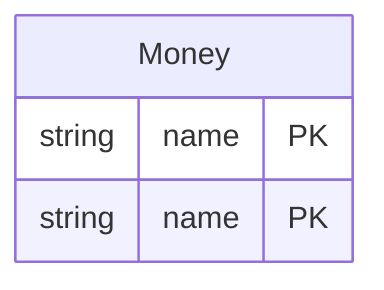

<!-- Code generated by protoc-gen-web3. DO NOT EDIT. -->

# `commerce` — The Graph subgraph

An off-chain index of the on-chain storage contracts — one @entity per resource.

Generated from Protobuf by protoc-gen-web3. Source of truth is the `.proto` files — regenerate rather than editing.

| Models | Enums |
| ---: | ---: |
| 2 | 2 |

## Entity relationships

## Output

- `schema.graphql` — one `@entity` per resource; foreign keys become references and the reverse side is a `@derivedFrom` list.
- `subgraph.yaml` — the manifest: one dataSource per resource contract, handling its `Created`/`Updated`/`Deleted` events. Fill in each contract `address` and `startBlock` after deployment.
- `abis/<Contract>.json` — the events and `get()` view each mapping binds to.
- `src/<schema>.ts` — AssemblyScript handlers that read a record via `get(key)` and upsert the entity; a Deleted event removes it.
- Build with the Graph CLI: `npm install` then `graph codegen && graph build` from this directory.

## Schema `shop_cart_v1`

### `Money` → `moneys`

Money is a cart-side resource. Its simple name "Money" collides with the order-side Money once both packages merge into the "commerce" database (see protorm.yaml). Prisma qualifies the colliding model names (its models share one global namespace), while the schema-namespaced targets — GORM (one package per schema), SQL, and CSV — keep the bare "Money", since the schema already disambiguates them.

| Column | Type | Null |
| --- | --- | --- |
| `name` | `string` | not null |
| `amount` | `int64` | not null |
| `status` | `Status` | not null |

### Enums

- `Status`: PENDING, PAID

## Schema `shop_order_v1`

### `Money` → `moneys`

Money is the order-side resource sharing the simple name "Money" with the cart-side one. See cart.proto for how each target renders the collision.

| Column | Type | Null |
| --- | --- | --- |
| `name` | `string` | not null |
| `amount` | `int64` | not null |
| `status` | `Status` | not null |

### Enums

- `Status`: SHIPPED, DELIVERED
