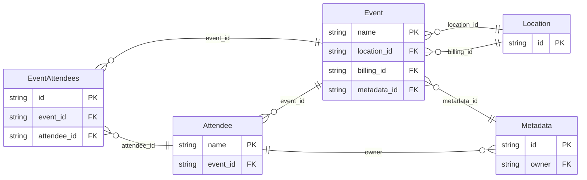

<!-- Code generated by protoc-gen-web3. DO NOT EDIT. -->

# `v1` — Solana programs

An Anchor program per schema — a PDA-backed account and create/update/close instructions per resource.

Generated from Protobuf by protoc-gen-web3. Source of truth is the `.proto` files — regenerate rather than editing.

| Models | Enums |
| ---: | ---: |
| 5 | 0 |

## Entity relationships

## Output

- `programs/<schema>/src/lib.rs` — the `#[program]` module: an `#[account]` struct per resource plus `create`/`update`/`close` instructions keyed by a PDA seeded on the record key. Writes are gated by the `access` model (open, program authority, or per-record owner).
- `programs/<schema>/Cargo.toml` — the program crate; `Anchor.toml` + `Cargo.toml` at the root form the workspace. Run `anchor build` from the database directory.
- Dynamic fields (String, Vec) carry `#[max_len(..)]` so `#[derive(InitSpace)]` can size the rent-exempt account; adjust the caps to your data.
- `declare_id!` carries an all-ones placeholder — run `anchor keys sync` to bind real program ids before deploying.

## Schema `embedded_v1`

### `Event` → `events`

Event exercises nested-message normalization: a singular message field becomes a belongs-to relation, a repeated message field becomes a has-many, while well-known and map fields stay scalar / JSONB.

| Column | Type | Null |
| --- | --- | --- |
| `name` | `String` | not null |
| `create_time` | `i64` | not null |
| `labels` | `String` | nullable |
| `location_id` | `String` | not null |
| `billing_id` | `String` | nullable |
| `metadata_id` | `String` | nullable |

### `Attendee` → `attendees`

Attendee carries an IDENTIFIER, so that field is its primary key.

| Column | Type | Null |
| --- | --- | --- |
| `name` | `String` | not null |
| `email` | `String` | not null |
| `event_id` | `String` | not null |

### `Location` → `locations`

Location is reachable from Event and so becomes its own table; its existing `id` field is promoted to the primary key.

| Column | Type | Null |
| --- | --- | --- |
| `id` | `String` | not null |
| `city` | `String` | not null |
| `venue` | `String` | nullable |

### `Metadata` → `metadatas`

Metadata is reachable only through Event.metadata and carries no resource annotation, yet it still becomes its own table (with a synthesized primary key) rather than an inlined JSONB blob.

| Column | Type | Null |
| --- | --- | --- |
| `id` | `String` | not null |
| `source` | `String` | nullable |
| `tags` | `Vec<String>` | nullable |
| `owner` | `String` | nullable |

### `EventAttendees` → `event_attendees`

Join table for the many-to-many relation Event.attendees ↔ Attendee.

| Column | Type | Null |
| --- | --- | --- |
| `id` | `String` | not null |
| `event_id` | `String` | not null |
| `attendee_id` | `String` | not null |
| `attendee_name` | `String` | not null |
