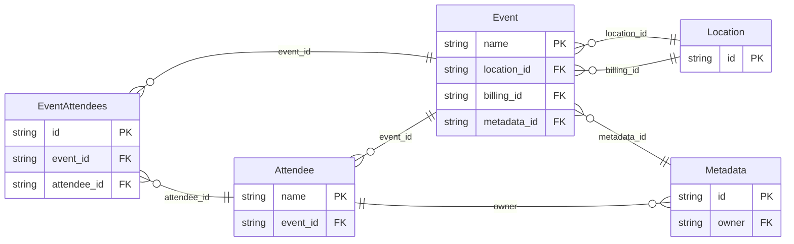

<!-- Code generated by protoc-gen-web3. DO NOT EDIT. -->

# `v1` — Solidity contracts

A self-contained CRUD storage contract per resource — one Solidity file per model.

Generated from Protobuf by protoc-gen-web3. Source of truth is the `.proto` files — regenerate rather than editing.

| Models | Enums |
| ---: | ---: |
| 5 | 0 |

## Entity relationships

## Output

- `<schema>/<Model>.sol` — one storage contract per resource: a struct mirroring the columns, a key→record mapping, and `create`/`get`/`update`/`remove`/`list`/`count`/`exists` functions with `Created`/`Updated`/`Deleted` events. Writes are gated by the `access` model (open, `Ownable`, or per-record owner).
- `<schema>/types.sol` — file-level Solidity enums shared by the schema's contracts; emitted when the schema declares enums.
- `foundry.toml` — Foundry project config; run `forge build` from this directory to compile the whole tree.
- Solidity has no NULL and no float: nullable columns use the type's zero value, and REAL/DOUBLE/UUID-style columns are stored as `string`. Foreign keys are stored as plain key fields (no cross-contract constraint is enforced on-chain).
- `SCHEMA_VERSION` — each contract exposes a `bytes32` fingerprint of its storage layout. The generated runtime client compares it to the deployed contract and refuses a mismatch, so an out-of-date contract is caught rather than silently mis-decoded.
- Schema evolution: these contracts are immutable, so regenerating after a `.proto` change means deploying a new contract (its `SCHEMA_VERSION` changes) and migrating data — replay the old contract's `Created`/`Updated` events into the new one, or backfill from the subgraph. For in-place upgrades keep the address stable behind an ERC-1967/UUPS proxy and only ever *append* struct fields (never reorder or retype), preserving the storage layout the proxy delegates into.

## Schema `embedded_v1`

### `Event` → `events`

Event exercises nested-message normalization: a singular message field becomes a belongs-to relation, a repeated message field becomes a has-many, while well-known and map fields stay scalar / JSONB.

| Column | Type | Null |
| --- | --- | --- |
| `name` | `string` | not null |
| `create_time` | `uint256` | not null |
| `labels` | `string` | nullable |
| `location_id` | `string` | not null |
| `billing_id` | `string` | nullable |
| `metadata_id` | `string` | nullable |

### `Attendee` → `attendees`

Attendee carries an IDENTIFIER, so that field is its primary key.

| Column | Type | Null |
| --- | --- | --- |
| `name` | `string` | not null |
| `email` | `string` | not null |
| `event_id` | `string` | not null |

### `Location` → `locations`

Location is reachable from Event and so becomes its own table; its existing `id` field is promoted to the primary key.

| Column | Type | Null |
| --- | --- | --- |
| `id` | `string` | not null |
| `city` | `string` | not null |
| `venue` | `string` | nullable |

### `Metadata` → `metadatas`

Metadata is reachable only through Event.metadata and carries no resource annotation, yet it still becomes its own table (with a synthesized primary key) rather than an inlined JSONB blob.

| Column | Type | Null |
| --- | --- | --- |
| `id` | `string` | not null |
| `source` | `string` | nullable |
| `tags` | `string[]` | nullable |
| `owner` | `string` | nullable |

### `EventAttendees` → `event_attendees`

Join table for the many-to-many relation Event.attendees ↔ Attendee.

| Column | Type | Null |
| --- | --- | --- |
| `id` | `string` | not null |
| `event_id` | `string` | not null |
| `attendee_id` | `string` | not null |
| `attendee_name` | `string` | not null |
