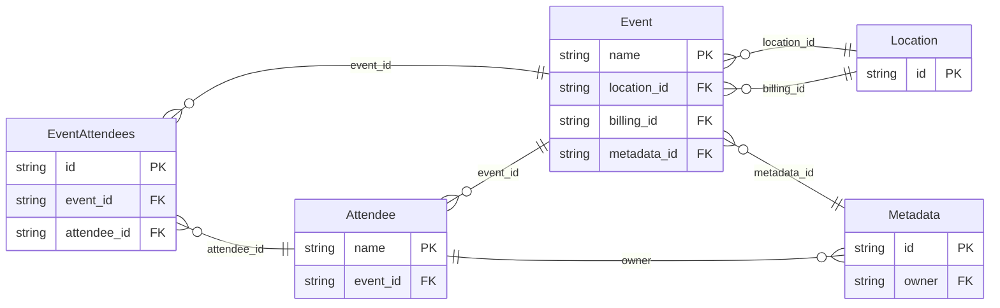

<!-- Code generated by protoc-gen-web3. DO NOT EDIT. -->

# `v1` — The Graph subgraph

An off-chain index of the on-chain storage contracts — one @entity per resource.

Generated from Protobuf by protoc-gen-web3. Source of truth is the `.proto` files — regenerate rather than editing.

| Models | Enums |
| ---: | ---: |
| 5 | 0 |

## Entity relationships

## Output

- `schema.graphql` — one `@entity` per resource; foreign keys become references and the reverse side is a `@derivedFrom` list.
- `subgraph.yaml` — the manifest: one dataSource per resource contract, handling its `Created`/`Updated`/`Deleted` events. Fill in each contract `address` and `startBlock` after deployment.
- `abis/<Contract>.json` — the events and `get()` view each mapping binds to.
- `src/<schema>.ts` — AssemblyScript handlers that read a record via `get(key)` and upsert the entity; a Deleted event removes it.
- Build with the Graph CLI: `npm install` then `graph codegen && graph build` from this directory.

## Schema `embedded_v1`

### `Event` → `events`

Event exercises nested-message normalization: a singular message field becomes a belongs-to relation, a repeated message field becomes a has-many, while well-known and map fields stay scalar / JSONB.

| Column | Type | Null |
| --- | --- | --- |
| `name` | `string` | not null |
| `create_time` | `uint256` | not null |
| `labels` | `string` | nullable |
| `location_id` | `string` | not null |
| `billing_id` | `string` | nullable |
| `metadata_id` | `string` | nullable |

### `Attendee` → `attendees`

Attendee carries an IDENTIFIER, so that field is its primary key.

| Column | Type | Null |
| --- | --- | --- |
| `name` | `string` | not null |
| `email` | `string` | not null |
| `event_id` | `string` | not null |

### `Location` → `locations`

Location is reachable from Event and so becomes its own table; its existing `id` field is promoted to the primary key.

| Column | Type | Null |
| --- | --- | --- |
| `id` | `string` | not null |
| `city` | `string` | not null |
| `venue` | `string` | nullable |

### `Metadata` → `metadatas`

Metadata is reachable only through Event.metadata and carries no resource annotation, yet it still becomes its own table (with a synthesized primary key) rather than an inlined JSONB blob.

| Column | Type | Null |
| --- | --- | --- |
| `id` | `string` | not null |
| `source` | `string` | nullable |
| `tags` | `string[]` | nullable |
| `owner` | `string` | nullable |

### `EventAttendees` → `event_attendees`

Join table for the many-to-many relation Event.attendees ↔ Attendee.

| Column | Type | Null |
| --- | --- | --- |
| `id` | `string` | not null |
| `event_id` | `string` | not null |
| `attendee_id` | `string` | not null |
| `attendee_name` | `string` | not null |
