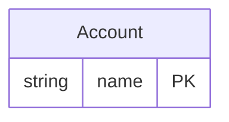

<!-- Code generated by protoc-gen-web3. DO NOT EDIT. -->

# `reserved_db` — Solana programs

An Anchor program per schema — a PDA-backed account and create/update/close instructions per resource.

Generated from Protobuf by protoc-gen-web3. Source of truth is the `.proto` files — regenerate rather than editing.

| Models | Enums |
| ---: | ---: |
| 1 | 1 |

## Entity relationships

## Output

- `programs/<schema>/src/lib.rs` — the `#[program]` module: an `#[account]` struct per resource plus `create`/`update`/`close` instructions keyed by a PDA seeded on the record key. Writes are gated by the `access` model (open, program authority, or per-record owner).
- `programs/<schema>/Cargo.toml` — the program crate; `Anchor.toml` + `Cargo.toml` at the root form the workspace. Run `anchor build` from the database directory.
- Dynamic fields (String, Vec) carry `#[max_len(..)]` so `#[derive(InitSpace)]` can size the rent-exempt account; adjust the caps to your data.
- `declare_id!` carries an all-ones placeholder — run `anchor keys sync` to bind real program ids before deploying.

## Schema `public`

### `Account` → `user`

Account is forced onto the reserved table name "user" via a table override, with reserved-word columns and a composite UNIQUE index over them.

| Column | Type | Null |
| --- | --- | --- |
| `name` | `String` | not null |
| `order` | `String` | nullable |
| `select` | `String` | nullable |
| `state` | `State` | nullable |

### Enums

- `State`: ACTIVE, CLOSED
