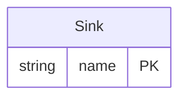

<!-- Code generated by protoc-gen-web3. DO NOT EDIT. -->

# `wkt_db` — The Graph subgraph

An off-chain index of the on-chain storage contracts — one @entity per resource.

Generated from Protobuf by protoc-gen-web3. Source of truth is the `.proto` files — regenerate rather than editing.

| Models | Enums |
| ---: | ---: |
| 1 | 0 |

## Entity relationships

## Output

- `schema.graphql` — one `@entity` per resource; foreign keys become references and the reverse side is a `@derivedFrom` list.
- `subgraph.yaml` — the manifest: one dataSource per resource contract, handling its `Created`/`Updated`/`Deleted` events. Fill in each contract `address` and `startBlock` after deployment.
- `abis/<Contract>.json` — the events and `get()` view each mapping binds to.
- `src/<schema>.ts` — AssemblyScript handlers that read a record via `get(key)` and upsert the entity; a Deleted event removes it.
- Build with the Graph CLI: `npm install` then `graph codegen && graph build` from this directory.

## Schema `kitchen`

### `Sink` → `sinks`

Sink is one table holding every interesting type mapping.

| Column | Type | Null |
| --- | --- | --- |
| `name` | `string` | not null |
| `flag` | `bool` | nullable |
| `count32` | `int32` | nullable |
| `count64` | `int64` | nullable |
| `ratio` | `string` | nullable |
| `precise` | `string` | nullable |
| `blob` | `bytes` | nullable |
| `event_time` | `uint256` | nullable |
| `window` | `string` | nullable |
| `mask` | `string` | nullable |
| `maybe_count` | `int64` | nullable |
| `maybe_label` | `string` | nullable |
| `tags` | `string[]` | nullable |
| `scores` | `int32[]` | nullable |
| `attributes` | `string` | nullable |
